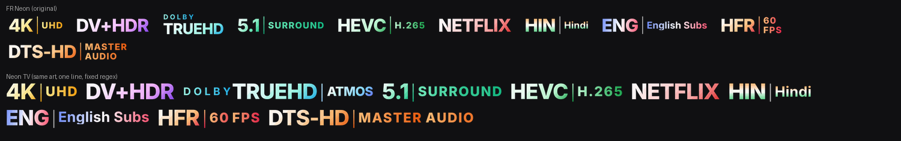

# Neon TV badges for Nuvio

The **Neon** style of [FR-Badges](https://github.com/farizmohd70/FR-Badges) (MIT),
re-laid for TV screens. The artwork is the original: same glyphs, gradients,
flag stripes and sheen. Each badge is cut into its parts (DOLBY eyebrow, main
word, separator, secondary label) and put back on one line, so the main word
fills the tag height instead of sharing it with stacked text.



## Use it in Nuvio

Profile → Layout → Streams → **Fusion badge URLs**, paste:

```
<BASE_URL>/neon-tv.json
```

Clear the app cache if old badges stick.

## Change or add a badge

Regexes and names live in `badges.source.json`; artwork lives in
`sources/neon/<id>.png` (the original Neon PNGs). To add a badge, add an entry
and its artwork, or combine two existing badges in `COMBOS` in `build.py`
(that's how TRUEHD | ATMOS and DIGITAL+ | ATMOS are made). Then rebuild:

```
pip install pillow
python3 build.py --base-url https://<user>.github.io/<repo>
```

That regenerates `badges/`, `neon-tv.json` and `preview.png`. Commit and push.
Layout tuning (sizes, gaps) is at the top of `tools/relayout.py`.

## Fixes over FR-Badges

- **Dolby audio always gets a badge.** TrueHD + Atmos and DD+ + Atmos have their
  own combo badges, and Dolby Vision no longer hides the audio badge.
- **Channels glued to codecs match**: `DDP5.1`, `AAC2.0`, `DTS5.1`.
- **5.1/7.1 survive a following number**: `5.1 2160p`, `7.1 2024`.
- **Codec boundaries**: `AAC2.0`, `DTS5.1` and `H 264` now match.

`tools/import_fr.py` is the one-off script that produced `badges.source.json`
from FR-Badges; you don't need it again.

## License

MIT. Patterns and colours derived from FR-Badges © farizmohd70 (MIT).
